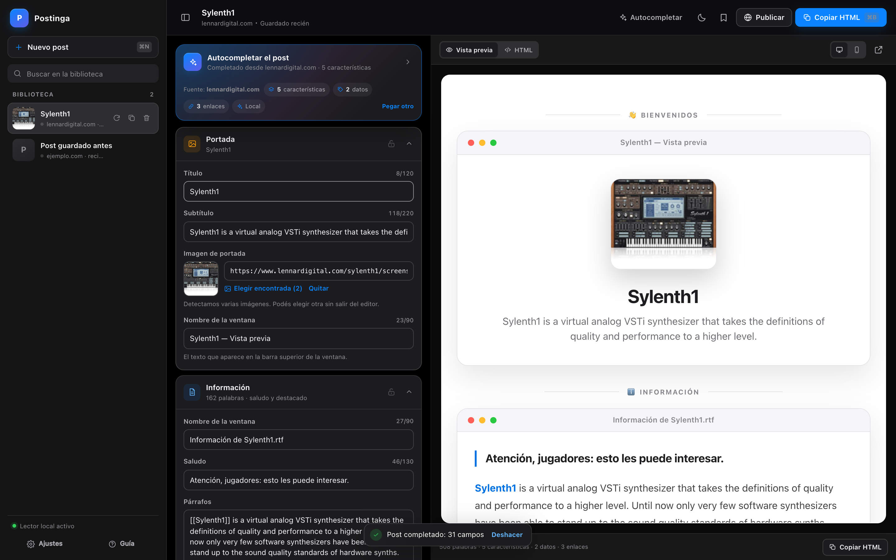
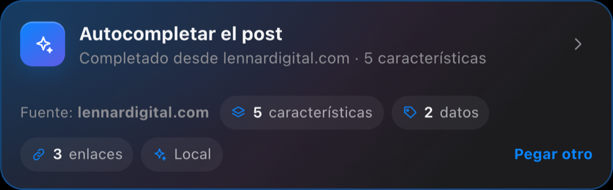
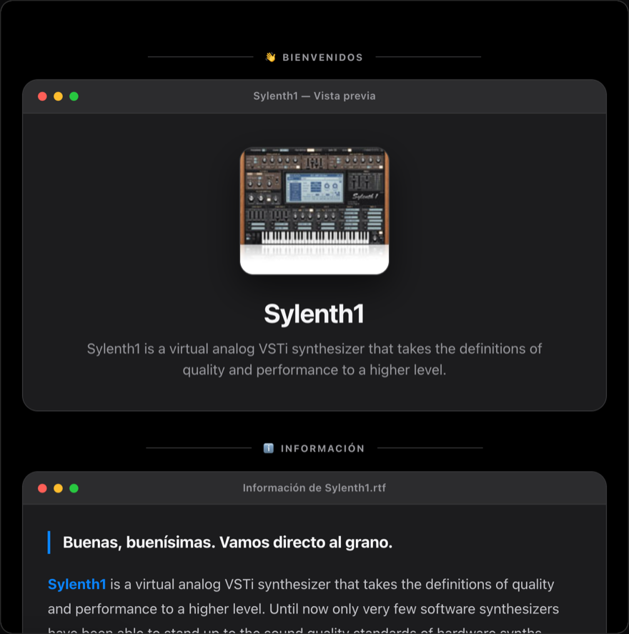
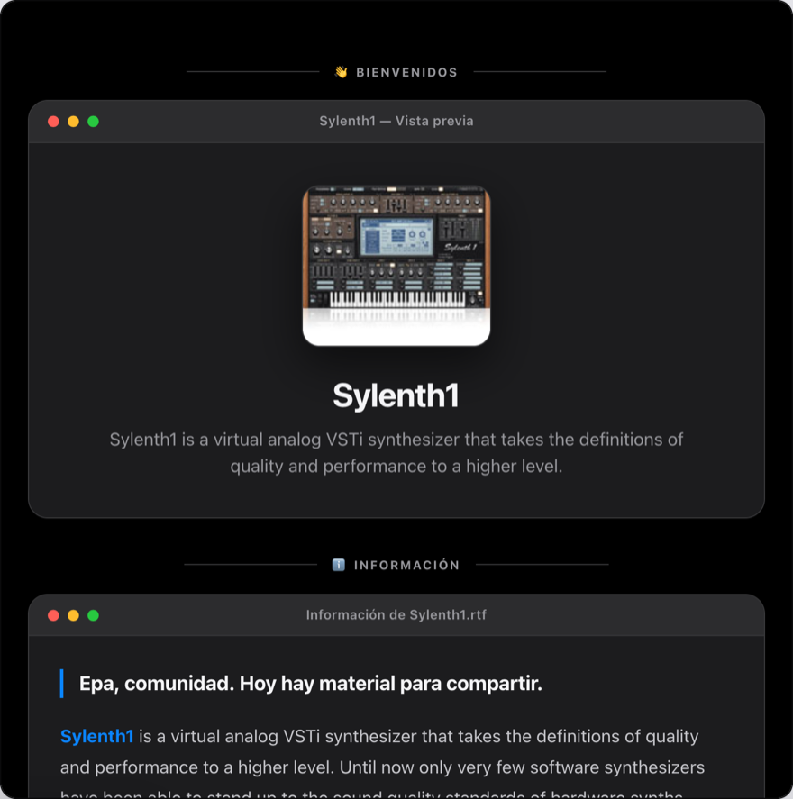
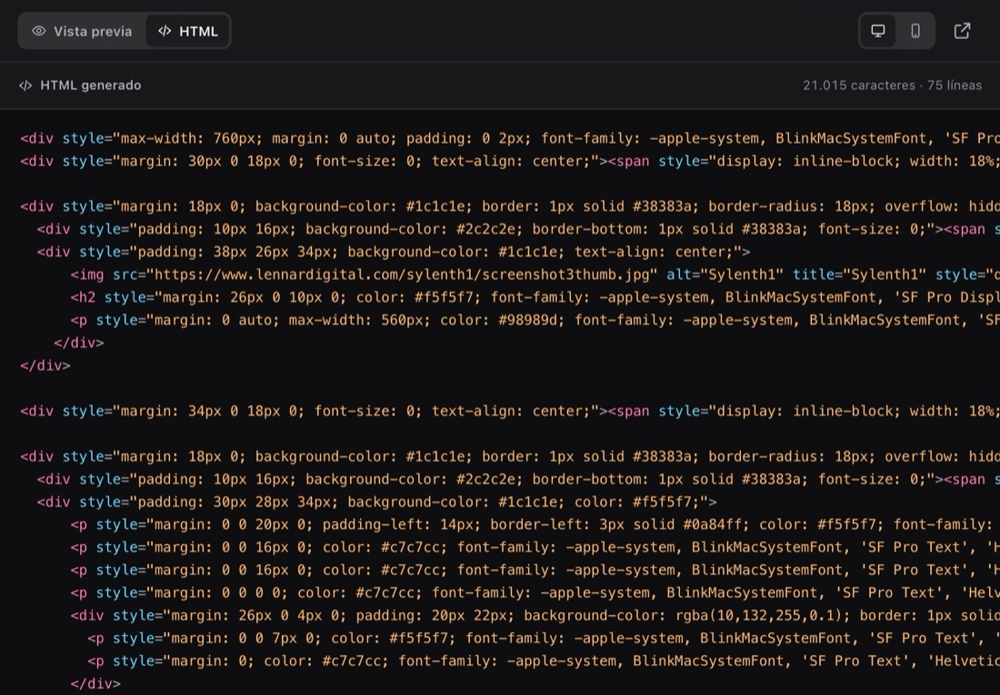
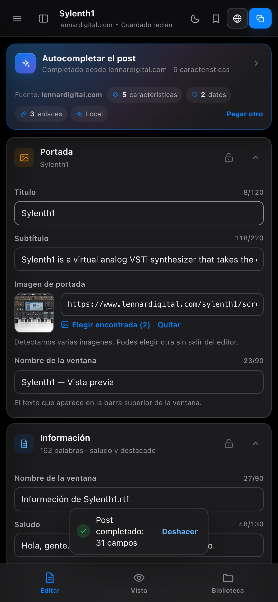

# Postinga

**Pegás un link. El post se escribe solo.**

Título, imagen, párrafos, características, ficha técnica y enlaces.
Todo completado por vos. Después copiás el HTML y lo pegás en tu sitio.

 

 

---

## ¿Qué es?

Una herramienta web que **arma el post por vos**.

Le das el enlace de una página —o el texto que ya tenés— y en segundos te devuelve el post
completo y ordenado: con su título, su imagen, los párrafos redactados, la lista de
características, la ficha técnica y los botones de descarga.

Vos solo revisás, ajustás lo que quieras y copiás el resultado.

> **Si sabés copiar y pegar, ya sabés usar esto.**

---

## El problema que resuelve

Armar un post largo es repetitivo: buscás el título, recortás la descripción, sacás la imagen,
armás la lista de características, averiguás los requisitos, juntás los links de descarga…
y lo repetís igual para el próximo.

|  | A mano | Con Postinga |
| --- | --- | --- |
| Armar un post | 20–40 minutos | **30 segundos** |
| Campos a completar | 20 o más | **ninguno** |
| Copiar datos y links | uno por uno | automático |
| Cambiar una parte | rehacer todo | **un clic**, con candados |
| Que se vea bien | depende del día | siempre igual |

---

## ¿Para qué lo podés usar?

- 🎛️ **Fichas de productos y programas**, con sus características y requisitos.
- 🎮 **Juegos, películas, música o libros**: sinopsis, datos y dónde conseguirlos.
- 📦 **Recopilaciones con links de descarga** que querés que se vean ordenadas.
- 🌎 **Contenido en otro idioma**, traducido y reescrito al español.
- 🗂️ **Varios posts a la vez**, guardados en una biblioteca y actualizables.

---

## Cómo se usa

### 1. Pegá el contenido

En el recuadro de arriba pegá **el link** de la página, o **todo el texto** si preferís.
También podés arrastrar un archivo `.txt`, `.md` o `.html`.

El indicador te avisa qué detectó antes de arrancar.

### 2. Apretá «Analizar y completar»

En segundos se llenan todas las secciones del post.

### 3. Revisá y ajustá

Todo queda editable y **la vista previa se actualiza mientras escribís**.
Podés cambiar la imagen, reescribir un párrafo o editar un botón sin salir de la pantalla.

 

### 4. Copiá y publicá

Apretá **Copiar HTML** (`⌘B`), entrá a crear la publicación en tu sitio, buscá el botón de
**modo HTML** (suele ser `</>` o «Fuente») y pegá ahí.

> [!WARNING]
> Pegalo siempre en el **modo HTML o Fuente**, no en el editor visual. En el modo visual se
> pierden los estilos y el post se ve plano.

---

## Todo lo que completa por vos

| Sección | Lo que llena |
| --- | --- |
| **Portada** | título, subtítulo, imagen principal y nombre de la ventana |
| **Información** | saludo, párrafos del cuerpo y un destacado |
| **Características** | entre 3 y 6 puntos, cada uno con etiqueta y color |
| **Ficha técnica** | entre 2 y 6 datos reales, ordenados por importancia |
| **Enlaces** | hasta 3 botones, priorizando descargas y sitio oficial |
| **Diseño** | paleta clara u oscura, color de acento y los separadores |

Reconoce solo de qué se trata —programa, juego, película, música, libro, hardware, tutorial o
noticia— y adapta los títulos y el tono de redacción.

> [!IMPORTANT]
> **No inventa nada.** Si un dato, una imagen o un enlace no está en la página que analizaste,
> ese campo queda vacío. Los enlaces del resultado siempre salen de la fuente real.

---

## Funciones que te van a servir

### 🔒 Candados: actualizá solo una parte

¿Encontraste una fuente mejor pero querés conservar la lista de características? Bloqueala y
volvé a analizar: esa sección no se toca, el resto se actualiza.

Cada sección tiene un **candado** en su cabecera, y siempre ves qué se va a conservar antes de
apretar el botón. También podés actualizar un post guardado **sin abrirlo**, desde la **⟳** en
la biblioteca.

### ⬇️ Descargas que bajan de verdad

Los links de OneDrive normalmente abren su portal con vista previa en vez de bajar el archivo.
La herramienta los **convierte sola** a enlace de descarga directa.

### 📚 Biblioteca

Cada post que generás queda guardado con su miniatura, el sitio y la fecha. Podés buscarlo,
duplicarlo, actualizarlo, eliminarlo o exportar todo como respaldo.

### 🤖 Redacción con IA (opcional)

Con una clave gratuita de Google, el post se **reescribe y traduce al español** con el tono que
elijas: *clásico*, *gamer* o *profesional*. Si la IA falla, el post se completa igual.

### 🌗 Se ve como una app de verdad

Tema claro u oscuro automático, vista previa de escritorio y de teléfono, biblioteca plegable
para ganar espacio, y atajos de teclado para no soltar el mouse.

<b>Ver los atajos</b>

| Acción | Atajo |
| --- | --- |
| Copiar el HTML | `⌘B` |
| Analizar el contenido | `⌘↵` |
| Nuevo post | `⌘N` |
| Guardar en la biblioteca | `⌘S` |
| Mostrar u ocultar la biblioteca | `⌘\` |
| Cerrar lo que esté abierto | `Esc` |

---

## Preguntas frecuentes

<b>¿Tengo que pagar algo o crear una cuenta?</b>

No. Se usa directo desde el navegador, sin registro. La IA es opcional: si la querés usar,
Google da claves gratuitas en [aistudio.google.com](https://aistudio.google.com).

<b>¿Funciona con cualquier sitio donde publique?</b>

Sí. El HTML que genera lleva el estilo incluido adentro, así que se ve igual en cualquier
editor que acepte pegar HTML. No está atado a ninguna plataforma.

<b>Un link no se puede leer, ¿qué hago?</b>

Algunos sitios bloquean a los lectores externos. Cuando pasa, la herramienta te avisa y te
ofrece pegarlo a mano: copiás el texto de la página, lo pegás en el recuadro y el enlace
original se conserva para los botones.

<b>¿Dónde se guardan mis posts?</b>

En tu propio navegador. No hay servidores ni cuentas, y nadie más los ve. Podés exportar un
respaldo desde Ajustes cuando quieras.

<b>Cambié algo, ¿se actualiza solo en mi sitio?</b>

No: el HTML se copia al momento de publicar. Si cambiás algo acá, tenés que volver a copiar
(`⌘B`) y reemplazar el contenido en tu sitio.

<b>¿Puedo usarlo sin internet?</b>

Podés abrir la app sin conexión y trabajar con texto pegado, pero para leer un link necesitás
internet.

---

## Empezá ahora

### [▶ Abrir Postinga](https://lnnb.github.io/postinga/)

Sin instalar nada. Se abre y funciona.

 

¿Preferís tenerlo en tu computadora? Descargá el proyecto y hacé doble clic en
<b>Iniciar Postinga.command</b>. Así además analiza los links de forma más confiable.

---

## Licencia

MIT. Podés usarlo, modificarlo y publicarlo libremente.

¿Sos desarrollador y querés meter mano? Está la [documentación técnica](docs/TECNICO.md).

 
Hecho para publicar más rápido, con posts que se ven bien.

